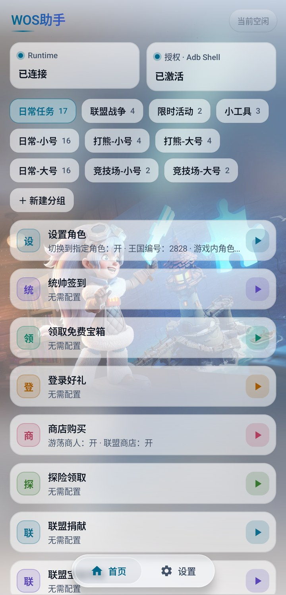
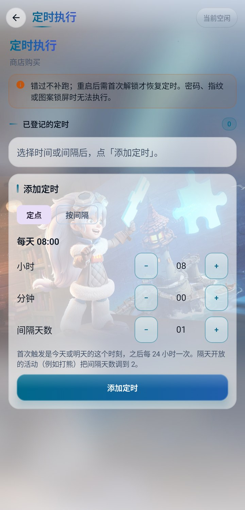
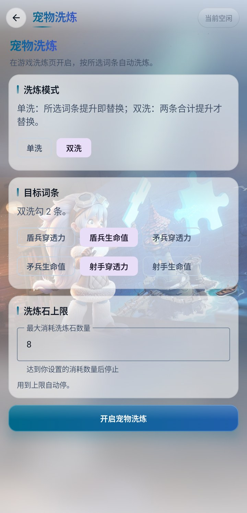

# MaaWos · WOS 助手

把重复的日常交给助手，把时间留给生活。

MaaWos 是基于 MaaFramework、在 Android 手机本地运行的《无尽冬日》助手。日常领取、资源采集、活动任务和实用小工具集中在一个 App 中，支持按自己的习惯组合任务、调整参数和安排执行时间。

**[下载正式版](https://github.com/zzmgoing/MaaWosDist/releases) · [使用反馈](https://nas-wos.zzming.cn:16606/feedback/) · [爱发电主页](https://afdian.com/a/maa-wos)**

## 核心功能

### 日常任务，集中处理

统帅签到、免费宝箱、登录好礼、探险领取、联盟捐献、联盟宝箱、海岛领取协助、宠物寻宝、商店购买、邮件清理和每日任务领取等常用操作，可单独执行，也可放入分组按顺序运行。

### 采集与活动，按需配置

- **自动灯塔、自动采集、自动野兽**：按任务参数执行日常资源与野外流程。
- **自动竞技场**：识别绿色战力，选择较弱对手，完成挑战并领取每日宝箱。
- **打熊、集结巨兽、物品集结、联盟总动员**：分别配置活动任务，配合分组与定时安排使用。
- **角色设置**：可在任务流程中切换到指定角色，为不同角色配置各自的任务分组。

### 自建分组与定时执行

把常用任务组成自己的日常清单，调整成员和顺序，为分组保存独立参数。单项任务与分组均支持定点、按间隔执行，也可设置间隔天数，安排隔天开放的活动。执行记录可查看运行结果与失败原因。

### 随手可用的小工具

| 小工具 | 用途 |
| --- | --- |
| 金手指连点器 | 悬浮按钮双击开始连点，单击或拖动停止 |
| 梦境寻忆 | 导入关卡模板或获取在线模板，在画面中圈出目标，提供寻物提示 |
| 宠物洗炼 | 选择单洗或双洗、目标词条与洗炼石消耗上限 |
| 堡垒抢车 | 在堡垒、要塞的集结列表中辅助抢车 |

### 让界面也合自己的习惯

支持浅色与深色主题、背景相册与自定义照片，以及经典或液态玻璃导航。任务配置、权限管理、应用更新和反馈入口都能在 App 内完成。

任务的截图、识别和点击在手机本地完成，无需电脑持续连接。账号登录、授权同步、在线模板和应用更新使用网络服务。

## 界面预览

以下为 Android 实机截图，展示首页、任务配置、定时执行与宠物洗炼。

<table>
  <tr>
    <th>任务首页与自建分组</th>
    <th>单项任务参数</th>
  </tr>
  <tr>
    <td></td>
    <td></td>
  </tr>
  <tr>
    <th>定时执行</th>
    <th>宠物洗炼</th>
  </tr>
  <tr>
    <td></td>
    <td></td>
  </tr>
</table>

## 下载与使用

1. 前往 [Releases 发布页](https://github.com/zzmgoing/MaaWosDist/releases)，在版本的 **Assets** 中下载正式 APK。发布页尚无安装包时，可使用 [应用下载页](https://nas-wos.zzming.cn:16606/download/)。
2. 安装后使用邮箱验证码登录，在「设置」中申请账号授权。
3. 在「设置 → 权限」配置 Root 或本机无线调试，按页面提示完成所需权限。
4. 选择任务，确认角色与参数；需要批量执行时建立分组，需要自动触发时添加定时。

支持 **Android 10 及以上的 64 位 ARM 设备**；本机无线调试通道需要 **Android 11 及以上**。运行时需联网确认登录与授权。定时触发时设备须处于可直接操作的状态，密码、指纹或图案锁屏时无法执行；错过的定时不会补跑。请按提示授予精确闹钟与后台运行所需权限。

已安装新版后，可在「设置 → 关于」检查更新。本仓库用于项目介绍、界面展示与正式 APK 发布。

## 支持项目

如果 MaaWos 帮你省下了时间，欢迎通过爱发电支持后续开发与维护。功能建议和使用问题也欢迎从 App 的「设置 → 反馈」提交。

点击下方推广图或扫描二维码，前往我的爱发电主页。

  

