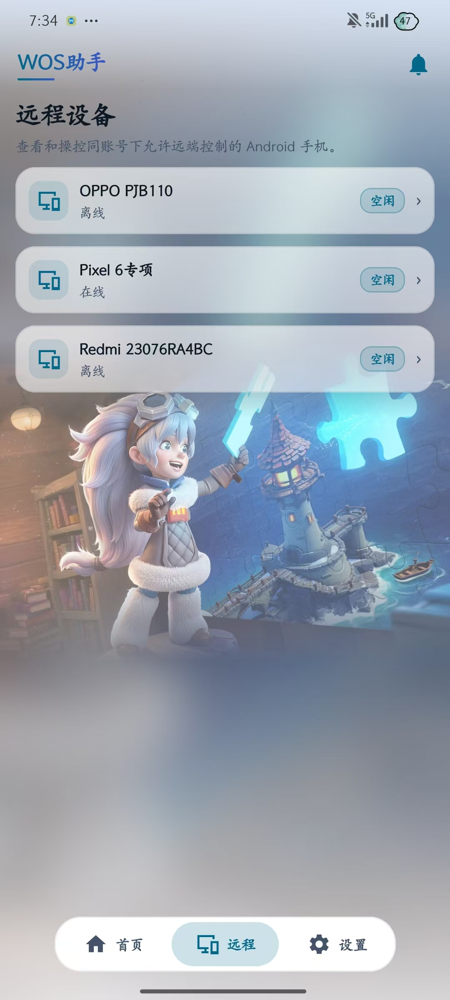
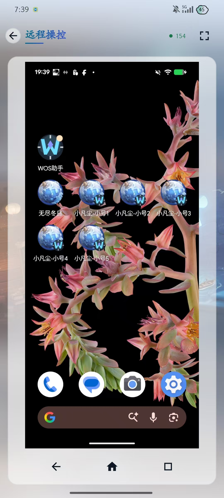
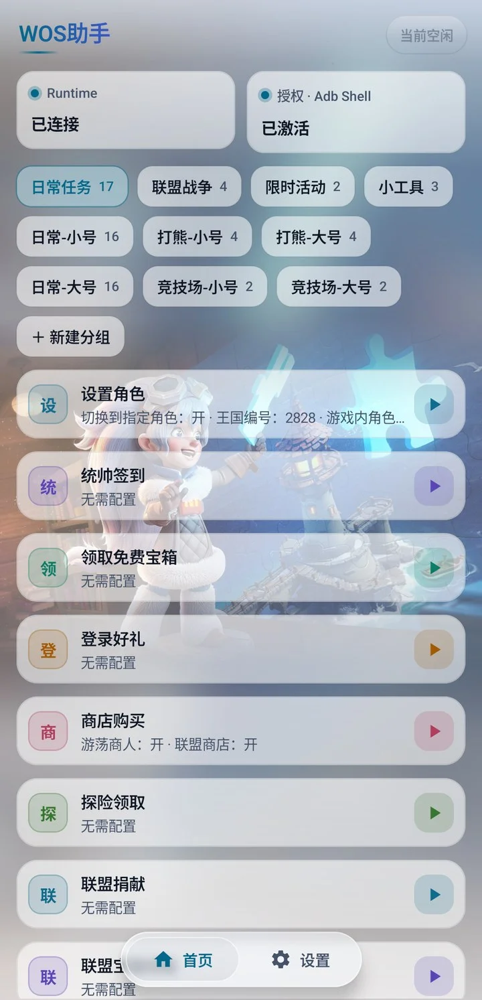
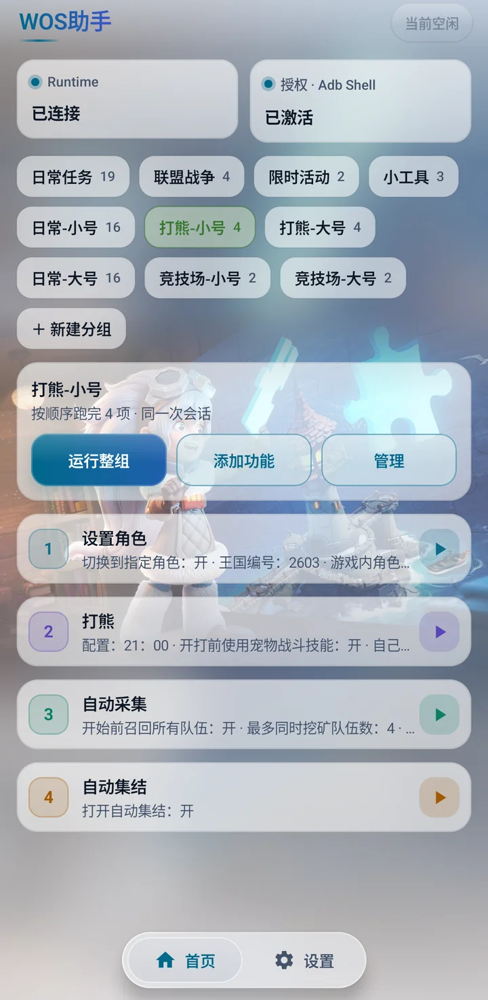
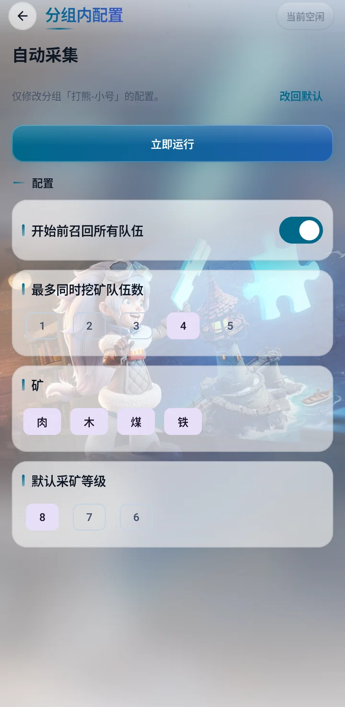
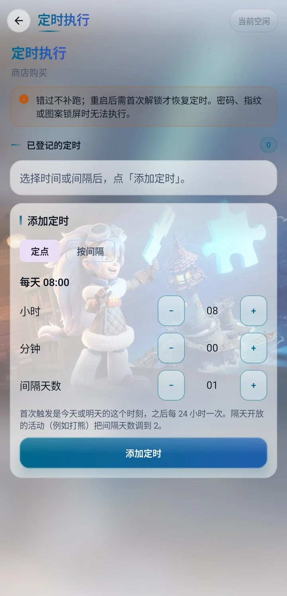
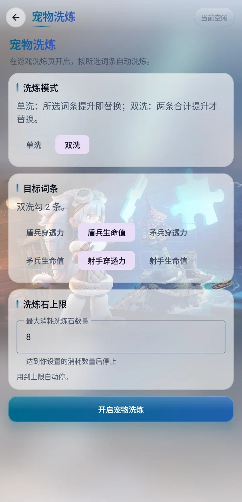
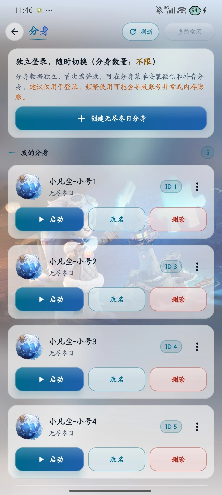
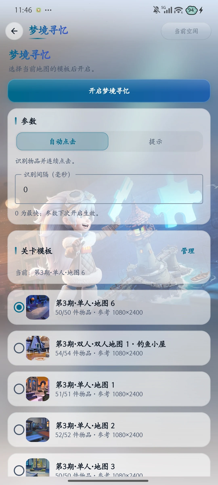

# MaaWos · WOS 助手

**远程随手操作，多个账号一处安排。**

MaaWos 是《无尽冬日》Android 助手。通过同账号设备实时看屏、点击与滑动，远程安排任务；为不同账号保留独立分身，再用游戏进程脚本完成重复日常。自动化在 Android 执行设备本地运行，无需电脑持续连接。

**[预览与下载](https://nas-wos.zzming.cn:16606/download/) · [GitHub Releases](https://github.com/zzmgoing/MaaWosDist/releases) · [使用反馈](https://nas-wos.zzming.cn:16606/feedback/) · [爱发电主页](https://afdian.com/a/maa-wos)**

## 核心功能

### 实时远控，随手掌控

- **实时看屏与操作**：连接同账号在线 Android 设备，点击、滑动或使用系统按键，支持全屏查看；无需先启动游戏。
- **任务远程安排**：管理目标设备的任务、分组与定时，查看执行结果，按需进入画面手动操作。
- **画面随网络调节**：H.264 支持硬件与软件编码，按网络情况调节码率；短暂中断恢复有效连接，不补发中断期间的触摸。
- **控制端无需 Root**：被控 Android 需要 Root 并开启被控模式，双方登录同一账号。

### 分身独立，切换从容

- **一个分身，一份数据**：分身数据独立，首次分别登录，为不同账号保留各自的游戏空间。
- **名称自定义，启动更直接**：在分身列表中改名、启动与管理，也可创建桌面快捷方式。
- **任务跟着分身走**：将任务目标绑定到指定分身，配合自建分组与定时，分别保存任务参数。
- **按账号权益使用**：VIP 月卡 ¥9.9／31 天，最多登录 2 台设备、全账号共 1 个分身；SVIP 月卡 ¥19.9／31 天，最多登录 5 台设备、分身数量不限。后台单独设置的额度优先。创建分身无需 Root；本机自动化与被控端需要 Root，控制端无需 Root。

**使用小贴士：前 66 名 VIP 用户永久升级 SVIP，享受不限数量的分身。** 按首次正式月卡到账顺序分配名额，永久升级的是会员等级，月卡仍需保持有效。

微信、抖音登录需通过对应分身菜单安装登录应用，在同一空间完成登录。建议仅用于登录，频繁使用可能导致账号异常或占用较多存储。

### 日常任务，集中处理

统帅签到、免费宝箱、登录好礼、探险领取、联盟捐献、联盟宝箱、海岛领取协助、宠物寻宝、商店购买、邮件清理和每日任务领取等常用操作，可单独执行，也可放入分组按顺序运行。

### 采集与活动，按需配置

- **自动灯塔、自动采集、自动野兽**：按任务参数执行日常资源与野外流程。
- **自动竞技场**：读取游戏数据，按配置选择对手、完成挑战并领取每日宝箱。
- **打熊、集结巨兽、物品集结、联盟总动员**：分别配置活动任务，配合分组与定时安排使用。
- **角色设置**：可在任务流程中切换到指定角色，为不同角色配置各自的任务分组。

### 自建分组与定时执行

把常用任务组成自己的日常清单，调整成员和顺序，为分组保存独立参数。单项任务与分组均支持定点、按间隔执行，也可设置间隔天数，安排隔天开放的活动。执行记录可查看运行结果与失败原因。

### 随手可用的小工具

| 小工具 | 用途 |
| --- | --- |
| 金手指连点器 | 悬浮按钮双击开始连点，单击或拖动停止 |
| 宠物洗炼 | 选择单洗或双洗、目标词条与洗炼石消耗上限 |
| 堡垒抢车 | 在堡垒、要塞的集结列表中辅助抢车 |

### 让界面也合自己的习惯

支持浅色与深色主题、背景相册与自定义照片，以及经典或液态玻璃导航。任务配置、权限管理、应用更新和反馈入口都能在 App 内完成。

任务通过游戏进程脚本在 Android 执行设备本地运行。远控需双方联网传输画面和输入；账号登录、授权同步与应用更新也使用网络服务。

## 界面预览

以下为 MaaWos Android 实机截图，与官网下载页保持相同顺序：远程设备列表、实时远控、任务首页、打熊小号分组、自动采集详情、定时、宠物洗炼、分身管理与梦境寻忆。点击图片可查看原图；截图中的分身数量为展示账号的权益。

<table>
  <tr><th>同账号设备，一处查看</th><th>实时看屏，远程操作</th></tr>
  <tr>
    <td></td>
    <td></td>
  </tr>
  <tr><th>任务与分组</th><th>打熊小号，独立安排</th></tr>
  <tr>
    <td></td>
    <td></td>
  </tr>
  <tr><th>自动采集，按需配置</th><th>安排好，再放心离开</th></tr>
  <tr>
    <td></td>
    <td></td>
  </tr>
  <tr><th>小工具，也很顺手</th><th>分身独立，随时切换</th></tr>
  <tr>
    <td></td>
    <td></td>
  </tr>
  <tr><th colspan="2">梦境寻忆，轻松寻物</th></tr>
  <tr>
    <td colspan="2" align="center"></td>
  </tr>
</table>

## 下载与使用

1. 在[预览与下载页](https://nas-wos.zzming.cn:16606/download/)查看应用界面并下载最新 APK，手机支持横滑截图、点击放大与底部快捷下载；也可前往 [Releases 发布页](https://github.com/zzmgoing/MaaWosDist/releases)，在版本的 **Assets** 中下载。
2. 安装后使用邮箱验证码登录，在「设置 → 我的账号」查看授权与分身权益。
3. 本机执行任务或作为被控端时，在「设置 → 权限」授予 Root；仅控制其他设备无需本机 Root。
4. 在分身页创建并登录游戏，或使用原游戏。选择任务并确认目标与参数；需要批量执行时建立分组，需要自动触发时添加定时。

支持 **Android 10 及以上的 ARM64 设备**；本机自动化与被控端需要 **Root**，无线调试不再作为自动化通道。游戏进程脚本当前适配 **无尽冬日 1.16.12（147）**，未适配任务会提示不可用。模拟器需支持 ARM64 应用与 Root。运行时需联网确认登录与授权。定时触发时设备须处于可直接操作的状态，密码、指纹或图案锁屏时无法执行；错过的定时不会补跑。请按提示授予精确闹钟与后台运行所需权限。

当前公开最新版为 **0.8.11-beta.4（versionCode 21）**，向全部用户提示更新。沿用原正式签名，Beta 1／2／3 可直接覆盖安装，无需卸载；从 0.8.10 及更早版本升级需重新验证邮箱登录。Beta 4 修复领主律令「立即生产」已成功颁布却误等普通资源通知、最终停止整组任务的问题，改为核对城市生产资源的服务端绝对库存与客户端实际写入；重连后只读核对原成功请求，不会重新颁布。继续核对满意值消耗、生效事件和冷却时间。官网、H5 与服务端同步，保留最新限时活动展示；iOS 构建号同步为 21，TestFlight 分发仍待 Apple 团队和上传凭据。旧版公开 Release 与 APK 在新版双端完整核验后下线，仅保留当前版本下载。

**模拟器 Beta 范围**：MuMu Android 12 已验证安装、登录、Root、实时画面、点击、滑动与短暂中断恢复；Android 15 已验证安装、登录与 Root 启动。模拟器游戏进程任务、高负载游戏画面和长时间稳定性仍待用户测试。遇到问题请通过使用反馈提供模拟器版本、Android 版本与复现步骤。旧版界面截图用于功能示意，具体显示以当前 App 为准。

本仓库用于项目介绍、界面展示与公开 APK 发布。Beta 作为公开最新版提供；请根据以上兼容要求升级。

## 邀请朋友

在 App「设置 → 邀请新用户」复制邀请码或分享邀请链接。朋友下载并使用邮箱登录后，在同一页面填写邀请码，双方各得 **7 天 VIP 授权**，授权天数可累加。每个账号仅可填写一次邀请码；下载页会展示链接携带的邀请码并提供复制按钮，链接不会自动绑定账号。

## 支持项目

如果 MaaWos 帮你省下了时间，欢迎通过爱发电支持后续开发与维护。功能建议和使用问题也欢迎从 App 的「设置 → 反馈」提交。

点击下方按钮，即可前往我的爱发电个人主页。

  

